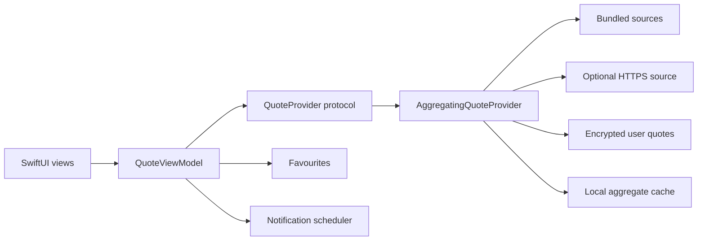

# Inner Whisper for iOS

Inner Whisper is a shipped, offline-first iPhone and iPad application built
with SwiftUI. This public portfolio edition demonstrates the production
architecture while replacing the full curated catalogue and licensed audio
with a small, original sample dataset.

The app delivers moments of reflection through an accessible quote browser,
favourites, user-authored encrypted quotes, configurable local notifications,
themes, and multilingual interface support.

## Engineering highlights

- Native Swift and SwiftUI with an MVVM boundary
- Protocol-oriented data sources and dependency injection
- Offline-first aggregation, stable ordering, and content deduplication
- Swift concurrency with `async`/`await`, actors, and `@MainActor` isolation
- AES-GCM encryption with keys stored in Keychain
- Local notification scheduling with blackout windows and bounded queues
- VoiceOver, Dynamic Type, Reduce Motion, and 44-point touch targets
- String-catalog localization architecture for eleven languages
- 169 XCTest methods across model, service, utility, view-model, and
  integration layers
- No third-party runtime dependencies

## Architecture



The application keeps rendering and interaction in SwiftUI views, state and
user intent in `QuoteViewModel`, and storage or platform integrations behind
focused services. `QuoteSource` implementations can be tested independently
and combined without changing the view layer.

## Guided code tour

- `InnerWhisper/Quotes/AggregatingQuoteProvider.swift` — offline-first source
  coordination, persistence, deduplication, and stable browse order
- `InnerWhisper/Quotes/QuoteSource.swift` — protocol-based bundle and HTTPS
  source implementations
- `InnerWhisper/Quotes/QuoteViewModel.swift` — main-actor state and navigation
- `InnerWhisper/Quotes/UserAddedQuotesStore.swift` — encrypted user content
- `InnerWhisper/Utilities/EncryptionManager.swift` and
  `KeychainManager.swift` — authenticated encryption and secure key storage
- `InnerWhisper/Utilities/NotificationManager.swift` — deterministic schedule
  generation and notification lifecycle management
- `InnerWhisperTests/` — 169 unit and integration test methods

## Run locally

Requirements:

- macOS with Xcode 26 or newer
- An iOS 26 simulator

Open `InnerWhisper.xcodeproj`, select the `InnerWhisper` scheme, and run the
app. Press Command-U to execute the test suite.

From Terminal:

```bash
xcodebuild test \
  -project InnerWhisper.xcodeproj \
  -scheme InnerWhisper \
  -destination 'platform=iOS Simulator,name=iPhone 16e,OS=26.2' \
  -parallel-testing-enabled NO
```

To run on a physical device, replace the example bundle and iCloud container
identifiers with identifiers owned by your Apple Developer account, then
select your development team in Xcode.

## Portfolio-edition boundaries

This repository intentionally excludes the production quote catalogue,
third-party notification audio, internal planning material, assistant
configuration, signing identity, and production Git history. Remote quote
loading is implemented but disabled by default.

The public snapshot is intended to make the engineering choices reviewable
without redistributing production content or internal operational material.

## Development note

Robin O'Brien directed the product, architecture, implementation, testing,
and release decisions. AI-assisted development tools were also used for code
review, localization support, and selected implementation work; all shipped
behaviour was reviewed and validated within the project.

## Licence

Source code is available under the MIT Licence. The Inner Whisper and Moving
Truth names, logos, icon, and brand assets are excluded from that grant. See
`ASSET_LICENSE.md` for the exact boundary.
